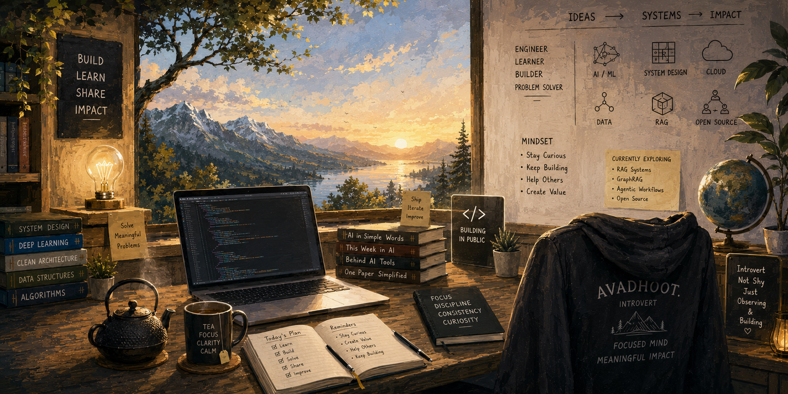

  

 

  

   

  
  
  <!--  -->
  

 

## 👨‍💻 About Me

I'm **Shreyash Daware**, an Artificial Intelligence and Data Science undergraduate at **Savitribai Phule Pune University**.

I enjoy building end-to-end software rather than working only on isolated models. My current focus is on **Agentic AI systems**, **LLM applications**, **Retrieval-Augmented Generation (RAG)**, **backend engineering**, **computer vision**, and **full-stack development**. I am particularly interested in how agents reason, select and execute tools, maintain state, and interact with external systems. I care about the engineering behind these systems: orchestration, data flow, APIs, persistence, evaluation, security, and deployment.
- 🔭 Building Agentic **AI systems**, Enterprise RAG, and KalaSetu.
- 🧠 Exploring agent orchestration, tool calling, multi-agent workflows, LLM engineering, retrieval systems, and computer vision.
- ⚙️ Interested in backend engineering, system design, and reliable AI-powered products.
- 🤝 Open to collaborating on useful developer tools, AI applications, and open-source projects.

| Project | What it does | Technologies |
|:--|:--|:--|
| [**Agentic AI — Tool-Using Agent Backend**](https://github.com/noNameDS09/ai_agents) | A production-oriented, tool-using agent backend built around a LangGraph agent loop. It exposes a FastAPI API and React/Vite interface, executes 31 allowlisted tools (26 local tools and 5 Tavily-backed web/research tools), and persists conversations and graph checkpoints in PostgreSQL. Includes API-key authentication, input validation, rate limiting, and audit events. The repository also documents ComplianceOS, a finance-compliance application planned around multi-agent workflows, RAG, and audit trails. | `Python 3.12` `FastAPI` `LangGraph` `OpenRouter` `PostgreSQL` `SQLAlchemy` `React` `Vite` `Tavily MCP` `pytest` `uv` |
| [**KalaSetu — SIH 2026**](https://github.com/noNameDS09/SIH2K26) | A voice-first AI platform for artisan product cataloging. It is designed to turn product photos and spoken descriptions into structured product information, pricing guidance, and market-ready listings, with support for regional-language workflows. | `Flutter` `Dart` `Next.js` `FastAPI` `LangChain` `LangGraph` `Firebase` `PostgreSQL` `Docker` |
| [**Enterprise RAG**](https://github.com/noNameDS09/enterprise-rag) | A document question-answering platform. Its retrieval pipeline uses Qdrant for dense retrieval, followed by deduplication, score filtering, and cross-encoder reranking. It also includes an evaluation framework for comparing retrieval and generation changes. | `Python` `FastAPI` `Next.js` `PostgreSQL` `Qdrant` `Redis` `Ollama` `Docker` `uv` |
| [**Wildlife Detection, Tracking & Counting**](https://github.com/noNameDS09/animal-detection-identification-counting) | A computer-vision pipeline for detecting animals in video, tracking individual detections with ByteTrack, and generating unique-animal summaries in JSON and CSV formats. | `Python` `YOLO` `ByteTrack` `PyTorch` `OpenCV` |
| [**SK Industries Website**](https://ski-mocha.vercel.app/) | A responsive industrial website created for a bakery-machinery manufacturer, with product-focused presentation and a modern web interface. | `Next.js` `React` `TypeScript` `UI/UX` `Vercel` |
---

### 

#### Core Programming Languages:
     
<!--  -->
<!--   -->
<!--    -->

#### Frontend Frameworks & Libraries:
  
<!--  
  -->
#### Backend & API Development:
  
<!--    -->

<!-- #### Mobile Development:
   -->

#### Cloud Platforms & DevOps:
     
<!--   -->

#### AI/ML & Data Science:
         

#### Databases & Storage:
    
<!--  -->
<!--   -->

#### Development Tools & Platforms:
      
  
<!--   -->

#### Operating Systems & Environments:
 
 

<!--  -->
<!--  -->

---

## 🚀 Featured Projects

| Project | Description | Tech Stack |
|:---|:---|:---:|
| **[FarmVichar]([https://github.com/](https://github.com/noNameDS09/FarmVicharMain))** | AI-driven agricultural platform with multilingual chat, commodity price prediction, and secure RESTful APIs. Built for Smart India Hackathon. | `React Native` `FastAPI` `Firebase` `Python` |
| **[Wildlife Detection Pipeline]([https://github.com/](https://github.com/noNameDS09/animal-detection-identification-counting))** | Real-time computer vision pipeline achieving 80% mAP across 19 animal classes with multi-object tracking at 25-30 FPS. | `YOLOv8` `ByteTrack` `PyTorch` `OpenCV` |
| **[SKI Industrial Website](https://ski-mocha.vercel.app/)** | Fully responsive corporate website for a bakery machinery manufacturer with SEO optimization and fast load times. | `Next.js` `Vercel` `UI/UX` `SEO` |
| **[Enterprise-RAG](https://github.com/noNameDS09/enterprise-rag)** |Enterprise RAG chatbot for organizational knowledge management with secure, citation-backed semantic search across PDFs, DOCX, PPTX, XLSX, emails, and more using hybrid retrieval, conversational memory, OCR, and role-based access control. | `Next.js` `React` `TypeScript` `FastAPI` `LangChain` `Qdrant` `PostgreSQL` `Docker` `Kubernetes` `Open-Source`|

  <h3>🤝 Connect with Me</h3>
  
Let's create something meaningful together!

  

   
  

